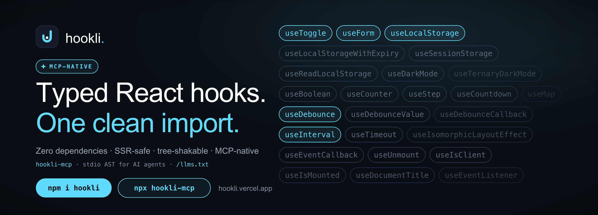

<!-- GENERATED — do not edit. Source: packages/hookli/README.md (run `pnpm --filter hookli run readme`). -->

<p align="center">
  <a href="https://www.npmjs.com/package/hookli">
    
  </a>
</p>

<h1 align="center">hookli</h1>

<p align="center">
  A tiny, typed collection of the React hooks you reach for every day.<br/>
  <strong>Every hook you rewrite — typed, SSR-safe, zero dependencies.</strong>
</p>

<p align="center">
  <a href="https://www.npmjs.com/package/hookli"></a>
  <a href="https://hookli.vercel.app/docs"></a>
  <a href="https://hookli.vercel.app/docs/mcp"></a>
  <a href="https://github.com/devsaifmohamed/hookli/actions/workflows/ci.yml"></a>
  <a href="https://www.npmjs.com/package/hookli"></a>
  <a href="https://github.com/devsaifmohamed/hookli"></a>
  <a href="https://github.com/sponsors/devsaifmohamed"></a>
  
</p>

<p align="center">
  
  
  
  
  
  
  
</p>

<p align="center">
  <a href="#-available-hooks"><strong>Browse the hooks &rarr;</strong></a>
</p>

<p align="center"><sub>Created by <a href="https://linkedin.com/in/devsaifmohamed/">Saif Mohamed</a> · ISC licensed</sub></p>

## 🚀 Quick Start

### 1. Install the Package
```bash
npm i hookli
# or: pnpm add hookli | yarn add hookli
```
> **Peer dependency:** React `>=18`.

### 2. Connect Your AI Agent (MCP)
hookli ships an official Model Context Protocol (MCP) server so **Cursor**, **Claude Code**, **Claude Desktop**, and **Windsurf** query verified TypeScript AST signatures over stdio with zero hallucinations:

```bash
npx -y hookli-mcp
```

For Cursor, simply add to `.cursor/mcp.json`:
```json
{
  "mcpServers": {
    "hookli": {
      "command": "npx",
      "args": ["-y", "hookli-mcp"]
    }
  }
}
```
> 📚 Complete MCP setup guide: <https://hookli.vercel.app/docs/mcp>

## 💫 Introduction

**hookli** is a React hooks library, written in TypeScript and ready to ship. It gives you a
small, dependency-free set of the hooks you reach for in almost every project — debounce,
`localStorage` wrappers, outside-click listeners, and the rest — so you stop rewriting the
same utilities for the hundredth time.

What sets hookli apart from similar libraries (including [usehooks-ts](https://usehooks-ts.com)):

- **Zero runtime dependencies** — not just "small deps," literally none besides React.
- **SSR-safe by convention** — every hook guards browser APIs; safe in Next.js and Remix.
- **AI-ready docs** — every hook is published as Markdown for LLMs ([`/llms.txt`](https://hookli.vercel.app/llms.txt), [`/llms-full.txt`](https://hookli.vercel.app/llms-full.txt)) with a **Copy for AI** button on each page.
- **Manifest-driven docs** — README, hook count, and the docs site all derive from one source of truth.
- **Live demos on the real package** — the docs import from npm, not a fork or snapshot.
- **Every hook tested** — colocated vitest tests and a CI gate on every PR.

### hookli vs usehooks-ts

|                                          |      hookli       | usehooks-ts        |
| ---------------------------------------- | :---------------: | :----------------: |
| Hooks                                    |      **66**       | ~33                |
| Runtime dependencies                     |       **0**       | `lodash.debounce`  |
| Written in TypeScript                    |         ✅         | ✅                  |
| Tree-shakable (ESM)                      |         ✅         | ✅                  |
| SSR-safe                                 |         ✅         | ✅                  |
| Native Model Context Protocol (MCP) server |     ✅ (`npx -y hookli-mcp`) | —                  |
| AI-ready docs (`llms.txt` + Copy for AI) |         ✅         | —                  |
| Live demos run the published npm build   |         ✅         | —                  |
| License                                  |        ISC        | MIT                |

<sub>Counts as of November 2026. Both are solid — pick what fits your project.</sub>

The library is designed to be as minimal as possible. It is fully **tree-shakable** (via the
ESM build), meaning you only ship the hooks you import and the rest is removed from your
bundle — the cost of adding hookli is negligible. Every hook is **typed** and **SSR-safe**,
so it drops straight into Next.js / Remix.

### Usage

```tsx
import { useLocalStorage } from "hookli";

function Component() {
  const { value, setStoredValue } = useLocalStorage("my-key", 0);

  // ...
}
```

## 🪝 Available hooks

> 📚 Full docs with a **page per hook** and **live demos**: <https://hookli.vercel.app/docs>
>
> 🤖 Using an AI assistant? Point it at [`/llms.txt`](https://hookli.vercel.app/llms.txt) or [`/llms-full.txt`](https://hookli.vercel.app/llms-full.txt), or hit **Copy for AI** on any hook page.

<!-- HOOKS:START — generated from each hook's TSDoc (run `pnpm readme`); do not edit by hand -->

### State (19)

- **[`useBoolean`](https://hookli.vercel.app/docs/use-boolean)** — A custom hook to manage a boolean value with convenient setters.
- **[`useMap`](https://hookli.vercel.app/docs/use-map)** — Manages a `Map` as immutable React state, returning a read-only view plus stable mutation helpers.
- **[`useTernaryDarkMode`](https://hookli.vercel.app/docs/use-ternary-dark-mode)** — Three-state dark-mode preference — `"system"`, `"dark"`, or `"light"` — persisted to `localStorage` and resolved against the OS color scheme.
- **[`useCounter`](https://hookli.vercel.app/docs/use-counter)** — A custom hook to manage a numeric counter.
- **[`useCountdown`](https://hookli.vercel.app/docs/use-countdown)** — A custom hook to manage a self-stopping countdown (or count-up) timer.
- **[`useDarkMode`](https://hookli.vercel.app/docs/use-dark-mode)** — Dark-mode boolean with toggle.
- **[`useForm`](https://hookli.vercel.app/docs/use-form)** — Controlled form state with one change handler.
- **[`useLocalStorage`](https://hookli.vercel.app/docs/use-local-storage)** — State persisted to localStorage.
- **[`useLocalStorageWithExpiry`](https://hookli.vercel.app/docs/use-local-storage-with-expiry)** — Persisted state with a TTL.
- **[`useReadLocalStorage`](https://hookli.vercel.app/docs/use-read-local-storage)** — Reads a `localStorage` key without writing it, re-rendering whenever the value changes in another tab (`storage` event) or via a `local-storage` custom event dispatched in this tab.
- **[`useSessionStorage`](https://hookli.vercel.app/docs/use-session-storage)** — `useState` backed by `sessionStorage`, synced across hooks in the same tab and across tabs via the `storage` event.
- **[`useStep`](https://hookli.vercel.app/docs/use-step)** — A custom hook to manage a 1-indexed step counter (e.g. for wizards/steppers).
- **[`useToggle`](https://hookli.vercel.app/docs/use-toggle)** — A custom hook to toggle a boolean value.
- **[`usePrevious`](https://hookli.vercel.app/docs/use-previous)** — Tracks the value from the previous render.
- **[`useList`](https://hookli.vercel.app/docs/use-list)** — Manages array state with a set of immutable helpers (`push`, `insertAt`, `updateAt`, `removeAt`, `clear`, `reset`).
- **[`useSet`](https://hookli.vercel.app/docs/use-set)** — Manages `Set` state with immutable helpers (`add`, `remove`, `toggle`, `has`, `clear`, `reset`).
- **[`useQueue`](https://hookli.vercel.app/docs/use-queue)** — Manages a FIFO queue with `add` (enqueue) and `remove` (dequeue) helpers.
- **[`useDefaultValue`](https://hookli.vercel.app/docs/use-default-value)** — Like `useState`, but reads back the `defaultValue` whenever the state is `null` or `undefined`.
- **[`useRafState`](https://hookli.vercel.app/docs/use-raf-state)** — A `useState` whose updates are batched to the next animation frame.

### Effects (16)

- **[`useDebounce`](https://hookli.vercel.app/docs/use-debounce)** — Debounces a changing value.
- **[`useDebounceCallback`](https://hookli.vercel.app/docs/use-debounce-callback)** — Creates a debounced version of `fn` that delays invoking it until `delayMs` have elapsed since the last call.
- **[`useDebounceValue`](https://hookli.vercel.app/docs/use-debounce-value)** — Tracks a value and returns a debounced copy that only updates after `delayMs` of inactivity.
- **[`useDocumentTitle`](https://hookli.vercel.app/docs/use-document-title)** — Keeps `document.title` in sync with the given `title`.
- **[`useEventCallback`](https://hookli.vercel.app/docs/use-event-callback)** — Wraps a function so it keeps a stable identity across renders while always calling the latest version.
- **[`useIsClient`](https://hookli.vercel.app/docs/use-is-client)** — Reports whether the component is running on the client.
- **[`useIsMounted`](https://hookli.vercel.app/docs/use-is-mounted)** — Returns a stable getter that reports whether the component is still mounted.
- **[`useInterval`](https://hookli.vercel.app/docs/use-interval)** — A custom hook that repeatedly calls a callback on a fixed interval.
- **[`useIsomorphicLayoutEffect`](https://hookli.vercel.app/docs/use-isomorphic-layout-effect)** — `useLayoutEffect` that safely falls back to `useEffect` on the server.
- **[`useTimeout`](https://hookli.vercel.app/docs/use-timeout)** — A custom hook that calls a callback once after a delay.
- **[`useUnmount`](https://hookli.vercel.app/docs/use-unmount)** — Runs a cleanup function exactly once, when the component unmounts.
- **[`useThrottle`](https://hookli.vercel.app/docs/use-throttle)** — Throttles a fast-changing value: the returned value updates at most once every `interval` milliseconds.
- **[`useUpdateEffect`](https://hookli.vercel.app/docs/use-update-effect)** — A variant of `useEffect` that **skips the initial mount** and only runs on subsequent dependency changes.
- **[`useEffectOnce`](https://hookli.vercel.app/docs/use-effect-once)** — Runs an effect exactly once, on mount.
- **[`usePageVisibility`](https://hookli.vercel.app/docs/use-page-visibility)** — Tracks whether the page/tab is currently visible via the Page Visibility API (`document.visibilityState`).
- **[`useDeepCompareEffect`](https://hookli.vercel.app/docs/use-deep-compare-effect)** — A `useEffect` that compares its dependencies by **deep** structural equality instead of reference.

### DOM (23)

- **[`useCopyToClipboard`](https://hookli.vercel.app/docs/use-copy-to-clipboard)** — Copies text to the clipboard via the async Clipboard API and tracks the last successfully-copied value.
- **[`useScript`](https://hookli.vercel.app/docs/use-script)** — Dynamically loads an external script and reports its load status.
- **[`useClickAnyWhere`](https://hookli.vercel.app/docs/use-click-any-where)** — Calls a handler on every click anywhere in the document.
- **[`useClickOutside`](https://hookli.vercel.app/docs/use-click-outside)** — Runs a callback on outside click.
- **[`useHover`](https://hookli.vercel.app/docs/use-hover)** — Tracks whether the pointer is currently hovering the referenced element.
- **[`useIntersectionObserver`](https://hookli.vercel.app/docs/use-intersection-observer)** — Observes an element's intersection with the viewport (or a custom root) via `IntersectionObserver`, exposing a ref callback to attach to the target.
- **[`useResizeObserver`](https://hookli.vercel.app/docs/use-resize-observer)** — Measures an element's size reactively via `ResizeObserver`.
- **[`useScrollLock`](https://hookli.vercel.app/docs/use-scroll-lock)** — Locks and restores scrolling on an element (the document body by default).
- **[`useEventListener`](https://hookli.vercel.app/docs/use-event-listener)** — Subscribes to an event on a media query, the window, the document, or an element, cleaning the listener up automatically.
- **[`useExpandableText`](https://hookli.vercel.app/docs/use-expandable-text)** — Collapse long text behind a "show more / less" toggle, capping it by a **character** budget, a **line** budget, or both — whichever clips first wins.
- **[`useInfiniteScroll`](https://hookli.vercel.app/docs/use-infinite-scroll)** — Triggers loading near the scroll end.
- **[`useMediaQuery`](https://hookli.vercel.app/docs/use-media-query)** — Tracks whether a CSS media query currently matches.
- **[`useMousePosition`](https://hookli.vercel.app/docs/use-mouse-position)** — Cursor coordinates within an element.
- **[`useScreen`](https://hookli.vercel.app/docs/use-screen)** — Tracks the `window.screen` object, refreshing it on every window resize.
- **[`useWindowSize`](https://hookli.vercel.app/docs/use-window-size)** — Tracks the viewport's `{ width, height }`, updating on every window resize.
- **[`useKeyPress`](https://hookli.vercel.app/docs/use-key-press)** — Tracks whether a specific key is currently held down.
- **[`useWindowScroll`](https://hookli.vercel.app/docs/use-window-scroll)** — Tracks the window's scroll position reactively.
- **[`useIdle`](https://hookli.vercel.app/docs/use-idle)** — Reports whether the user has been idle (no activity) for at least `ms` milliseconds.
- **[`useTextSelection`](https://hookli.vercel.app/docs/use-text-selection)** — Tracks the text the user has currently selected on the page (`window.getSelection()`), updating on every `selectionchange`.
- **[`useLongPress`](https://hookli.vercel.app/docs/use-long-press)** — Detects a long press (mouse or touch).
- **[`useHotkeys`](https://hookli.vercel.app/docs/use-hotkeys)** — Binds a keyboard shortcut to a callback.
- **[`useFullscreen`](https://hookli.vercel.app/docs/use-fullscreen)** — Controls the Fullscreen API for a referenced element and tracks whether it is currently fullscreen (via `fullscreenchange`).
- **[`useDraggable`](https://hookli.vercel.app/docs/use-draggable)** — Makes an element draggable with pointer events (mouse, touch and pen), with optional axis lock, live bounds, grid snapping, arrow-key moves and smoothing.

### Data (8)

- **[`useFetch`](https://hookli.vercel.app/docs/use-fetch)** — Declarative fetch with loading and error status.
- **[`useGeoLocation`](https://hookli.vercel.app/docs/use-geo-location)** — Browser geolocation state.
- **[`useAsync`](https://hookli.vercel.app/docs/use-async)** — Runs an async function and tracks its `{ loading, error, value }` state.
- **[`useMutation`](https://hookli.vercel.app/docs/use-mutation)** — Runs an async write action (create/update/delete) on demand and tracks its `status`, `data`, and `error` — the write-side companion to {@link useAsync}.
- **[`usePagination`](https://hookli.vercel.app/docs/use-pagination)** — Manages 1-indexed pagination state — page, page size, total pages, navigation helpers, and the current item `range`.
- **[`useNetworkState`](https://hookli.vercel.app/docs/use-network-state)** — Tracks the browser's network state — online/offline plus connection details where the Network Information API is available.
- **[`useBattery`](https://hookli.vercel.app/docs/use-battery)** — Reads the device battery via the Battery Status API and keeps it updated.
- **[`usePermission`](https://hookli.vercel.app/docs/use-permission)** — Queries the Permissions API for a permission and tracks its state reactively (it updates if the user later changes the setting).

<!-- HOOKS:END -->

## 🧪 TypeScript

Every hook ships its own declarations — no `@types/hookli` needed. Data hooks are generic,
so inference flows through:

```tsx
const { data } = useFetch<Product[]>("/api/products"); // data: Product[] | null
const debounced = useDebounce(query, 300); // debounced: typeof query
```

## 💖 Support hookli

hookli is free and open source, built and maintained in the open. If it saves you time:

- ⭐ **[Star the repo](https://github.com/devsaifmohamed/hookli)** — it's the #1 way to help others find it.
- 💖 **[Become a sponsor](https://github.com/sponsors/devsaifmohamed)** — fund ongoing maintenance and new hooks.

Every star and sponsorship genuinely helps keep this going. Thank you! 🙏

## 🤝 Contributing

Contributions of any size are welcome — see **[CONTRIBUTING.md](https://github.com/devsaifmohamed/hookli/blob/main/CONTRIBUTING.md)**. In short:
each hook lives in its own folder under `src/hooks/use-<name>/` (hook + colocated vitest test +
barrel), keep it SSR-safe, and make sure `pnpm typecheck && pnpm test && pnpm build` (typecheck + tests + build) is green.

## 📄 License

ISC © [Saif Mohamed](https://linkedin.com/in/devsaifmohamed/)
